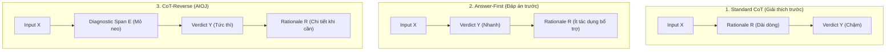
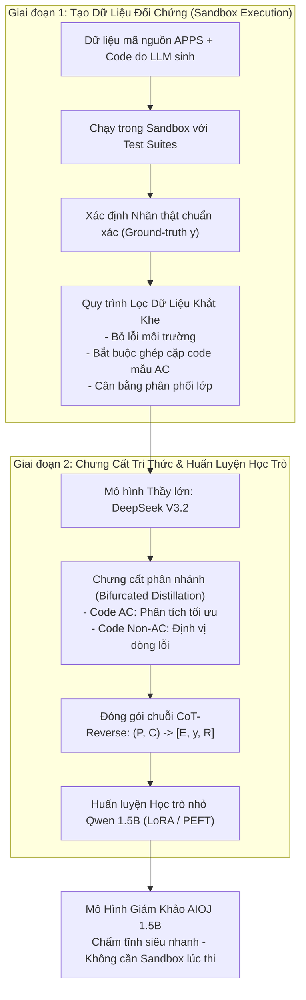
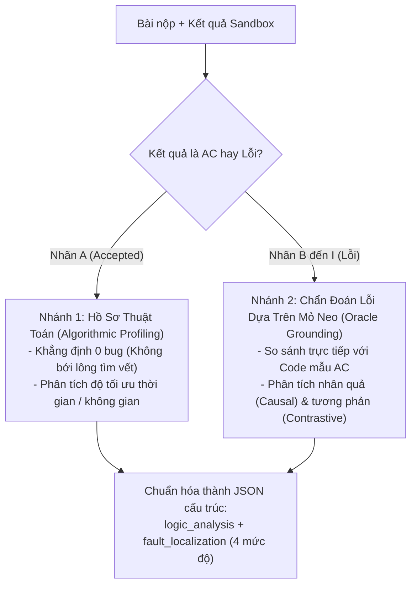
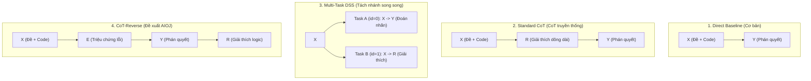

Chấm bài tập lập trình tự động cho học sinh, sinh viên chưa bao giờ là bài toán dễ dàng. Cho chạy trực tiếp code của sinh viên trên máy chủ thì tiềm ẩn nguy cơ bị hack, còn nhờ các mô hình AI khổng lồ như GPT-4 chấm thì lại quá chậm và tốn kém. Trong dự án này, chúng tôi phát triển **AIOJ**, một hệ thống AI nhỏ gọn có thể đọc hiểu code, bắt đúng bệnh và trả kết quả chấm ngay lập tức trên máy tính thông thường.

## Table of contents

## 1. Bối cảnh & Đặt vấn đề (Introduction)

Trong giáo dục khoa học máy tính hiện đại và các nền tảng lập trình thi đấu trực tuyến (như LeetCode, Codeforces), việc chấm bài tự động đóng vai trò thiết yếu để cung cấp phản hồi nhanh chóng, công bằng và có thể mở rộng quy mô. Khi các khóa học lập trình trực tuyến đại chúng (MOOCs) và chương trình giảng dạy đại học ngày càng đông học viên, việc giảng viên ngồi chấm bài thủ công hàng nghìn bài nộp là hoàn toàn bất khả thi. Các cơ sở giáo dục bắt buộc phải có một hệ thống chấm bài tự động vừa mạnh mẽ, vừa xử lý được khối lượng bài nộp khổng lồ.

Tuy nhiên, các phương pháp hiện nay đều đang đứng trước những ngõ cụt nghiêm trọng:

### Hạn chế chết người của cách chấm truyền thống (Sandbox Execution)
Từ trước đến nay, hầu hết các hệ thống trực tuyến đều chấm điểm bằng cách chạy thử mã nguồn của thí sinh trong một môi trường cách ly (sandbox) dựa trên các bộ đề kiểm tra (test cases) chuẩn bị sẵn. Dù phương pháp này kiểm tra trực tiếp hành vi lúc chạy, nó có 2 lỗ hổng không thể khắc phục:
1. **Phụ thuộc tuyệt đối vào độ bao phủ của bộ test case:** Nếu người ra đề ra thiếu test case ở các trường hợp biên tinh vi (edge cases như số 0, số âm, mảng rỗng), những giải pháp sai thuật toán nặng vẫn có thể dễ dàng lách qua và nhận kết quả đúng 100% (false-positive).
2. **Hiểm họa an toàn bảo mật máy chủ:** Việc cho phép chạy mã nguồn lạ do người dùng nộp lên tiềm ẩn nguy cơ bảo mật cực lớn. Mã độc có thể tạo vòng lặp vô tận đốt cháy CPU, làm cạn kiệt tài nguyên hệ thống, hoặc thậm chí tìm cách thoát khỏi hộp sandbox (host breakout) để chiếm quyền điều khiển máy chủ.

### Điểm yếu của việc dùng AI lớn trên đám mây (Cloud-scale LLMs)
Gần đây, các mô hình ngôn ngữ lớn (như GPT-4o, Claude 3.5 Sonnet) cho thấy năng lực suy luận tĩnh xuất sắc. Nhiều nơi đã thử nghiệm dùng LLM làm "giám khảo AI" (LLM-as-a-judge): AI chỉ cần đọc code và phân tích logic mà **không cần chạy thử file thực thi**, giải quyết triệt để rủi ro virus/hack máy chủ.

Tuy nhiên, đem các mô hình khổng lồ này vào thực tế trường học lại không khả thi:
1. **Chi phí API quá đắt đỏ (Prohibitive API Costs):** Mỗi lượt nộp bài phải trả tiền token cho nhà cung cấp. Với hàng trăm nghìn bài nộp mỗi học kỳ, hóa đơn sẽ lên tới hàng chục nghìn USD.
2. **Độ trễ phản hồi quá cao (Inference Latency):** AI lớn mất từ 5 đến 15 giây để suy nghĩ. Khi hàng trăm sinh viên cùng nhấn nộp bài vào những phút cuối giờ thi, hệ thống sẽ nghẽn cứng ngắc.
3. **Quyền riêng tư dữ liệu (Data Privacy):** Nhiều trường học và kỳ thi bảo mật không thể gửi dữ liệu bài thi của sinh viên lên máy chủ bên thứ ba.
4. **Kém trong việc bắt các loại lỗi kỹ thuật sâu:** Các cách hỏi (prompting) thông thường thường thất bại trong việc phân loại chính xác các lỗi cụ thể như Chạy quá thời gian (TLE - Time Limit Exceeded) hay Lỗi thực thi bộ nhớ (RE - Runtime Error).

### Ba Đóng Góp Chính của Bài Báo (Main Contributions)
1. **Thiết lập mô hình chấm code tĩnh toàn diện:** Biến bài toán chấm code thành quy trình kết hợp giữa việc sinh lời giải thích (rationale generation) và phân loại kết quả (verdict classification), tạo ra một quy trình đánh giá tĩnh từ đầu đến cuối (end-to-end) mà **hoàn toàn không cần chạy mã nguồn lúc triển khai**.
2. **Quy trình chưng cất chuỗi suy nghĩ CoT hiệu quả:** Xây dựng khung chưng cất tri thức chuyển giao chuỗi suy luận có cấu trúc từ LLM giáo viên sang LLM học sinh nhỏ gọn (Decoder-Only) bằng kỹ thuật tinh chỉnh tham số LoRA siêu nhẹ.
3. **Đánh giá thực nghiệm sâu rộng:** Kiểm chứng toàn diện trên các bộ dữ liệu lập trình thi đấu ở nhiều mức độ khó khác nhau (Easy, Medium, Hard). Kết quả chứng minh mô hình giám khảo tí hon đạt độ chính xác tương đương các mô hình nền tảng lớn hơn gấp nhiều lần, trong khi cắt giảm tối đa dung lượng bộ nhớ RAM/VRAM và độ trễ phản hồi.

---

## 2. Các Nghiên Cứu Liên Quan (Related Work)

Để hiểu rõ tại sao phương pháp của AIOJ ra đời, chúng ta cần nhìn lại các công trình nền tảng đi trước:

### 2.1. Đánh Giá Mã Nguồn & Chẩn Đoán Lỗi Tĩnh (Code Assessment & Static Bug Diagnosis)

Lịch sử đánh giá mã nguồn đã trải qua 3 giai đoạn chính:

#### 1. Kiểm thử động truyền thống (Dynamic Execution)
- Phương pháp cốt lõi là đo tỷ lệ vượt qua test suite, thường dùng chỉ số $pass@k$.
- Cách này bị giới hạn hoàn toàn bởi độ phủ của test case và luôn đối mặt với rủi ro bảo mật môi trường sandbox.

#### 2. Phân tích tĩnh đời đầu bằng cú pháp và Token (Early Static Analysis)
- Khi không thể chạy thử code, các nhà nghiên cứu dùng các độ đo dựa trên chuỗi từ khóa (token-level) hoặc cây cú pháp trừu tượng (tree-based metrics như CodeBLEU).
- Một số phương pháp áp dụng Machine Learning truyền thống để định vị lỗi (bug localization) và dự đoán khiếm khuyết phần mềm (defect prediction).
- **Hạn chế lớn:** Các phương pháp này chỉ so khớp câu chữ hoặc cấu trúc bề nổi. Chúng **hoàn toàn không hiểu được tính tương đương về mặt ngữ nghĩa (semantic equivalence)** — ví dụ hai đoạn code viết thuật toán khác nhau nhưng cùng giải ra một kết quả thì các công cụ này không nhận biết được. Đồng thời, chúng bất lực trước việc phân loại các nhóm lỗi chồng chéo phức tạp.

#### 3. Kỷ nguyên Mô hình Ngôn ngữ Lớn làm Giám khảo (LLM-as-a-Judge)
- Các công trình tiêu biểu gần đây như **CODEJUDGE (Tong & Zhang, 2024)** đã tận dụng khả năng suy luận cẩn trọng qua các câu nhắc (prompting) để ước lượng chất lượng mã nguồn mà không cần chạy code.
- Kế thừa hướng đi này, bộ benchmark **CodeJudge-Eval (Zhao et al., 2025)** đã nâng độ khó lên một tầm cao mới: Yêu cầu mô hình phải phân loại bài nộp vào hệ thống **9 nhóm nhãn lỗi chi tiết** (gồm cả TLE, RE, WA và lỗi kết hợp đa tầng).
- **Phát hiện quan trọng:** Ngay cả các mô hình AI thương mại hàng đầu (như GPT-4, Claude) cũng bị tụt độ chính xác rất mạnh khi phải chẩn đoán lỗi tĩnh chi tiết. Điều này khẳng định sự cần thiết của một mô hình AI chuyên dụng cho chẩn đoán lỗi.

---

### 2.2. Chưng Cất Tri Thức Suy Luận Sang Mô Hình Nhỏ (Reasoning Distillation in Compact Models)

Làm sao để một mô hình nhỏ xíu có thể thông minh như một mô hình khổng lồ? Câu trả lời nằm ở công nghệ chưng cất tri thức:

#### 1. Bản chất của Chưng cất tri thức (Knowledge Distillation - KD)
- Xuất phát từ nghiên cứu kinh điển của Hinton et al. (2015), **Knowledge Distillation** là kỹ thuật chuyển giao năng lực dự đoán từ một mạng "Thầy" khổng lồ (Teacher) sang một mạng "Trò" nhỏ gọn (Student) để dễ triển khai vào thực tế.
- **Vấn đề khi dạy theo kiểu cũ:** Trong các bài toán đòi hỏi suy luận phức tạp, nếu ta chỉ bắt mô hình nhỏ học vẹt theo nhãn đầu ra (output labels) như "Đúng" hay "Sai", mô hình nhỏ sẽ rơi vào tình trạng **học vẹt ghi nhớ (severe memorization)** mà không hề hiểu bản chất logic.

#### 2. Chưng cất chuỗi tư duy (Rationale Distillation)
- Để giải quyết bài toán trên, kỹ thuật chưng cất lý do (Rationale Distillation) ra đời: Thay vì chỉ lấy đáp án, người ta trích xuất toàn bộ **chuỗi suy luận từng bước (Chain-of-Thought - CoT traces)** của mô hình Thầy lớn (Wei et al., 2022) để dạy cho học trò nhỏ cách tư duy suy diễn đa bước (Magister et al., 2023; Fu et al., 2023).
- **Cột mốc Distilling Step-by-Step (DSS):** Nghiên cứu của Hsieh et al. (2023) đã tạo nên bước đột phá khi đưa cả việc đoán nhãn $Y$ và việc sinh chuỗi tư duy giải thích $R$ vào chung hàm mất mát đa nhiệm (multi-task loss). Nhờ đó, mô hình nhỏ không chỉ học nhãn mà bị ép phải học cả dòng chảy tư duy logic của mô hình lớn.
- **Kết hợp với LoRA (PEFT):** Khi kết hợp chưng cất chuỗi CoT với kỹ thuật tinh chỉnh tiết kiệm tham số LoRA (Hu et al., 2022), việc huấn luyện các mô hình nhỏ gọn ($\le 1.5\text{B}$ tham số) có sức mạnh cạnh tranh sòng phẳng với các mô hình lớn trở nên hoàn toàn khả thi.

#### 3. Khoảng trống nghiên cứu mà AIOJ lấp đầy (The Research Gap)
Mặc dù chưng cất suy luận đã rất phát triển, nhưng hầu hết các nghiên cứu trước đây trong ngành phần mềm chỉ tập trung vào:
- Sinh mã nguồn (code generation), hoặc
- Phân loại nhị phân đơn giản (code đúng hay code sai).

Việc ứng dụng chưng cất suy luận để **chẩn đoán chi tiết và phân loại các tổ hợp lỗi chồng chéo phức tạp (fine-grained diagnostic classification of composite error combinations)** vẫn là một mảnh đất hoàn toàn bị bỏ ngỏ. Đây chính là khoảng trống học thuật mà dự án AIOJ nhắm tới để giải quyết trọn vẹn.

---

### 2.3. Thứ Tự Chuỗi Suy Luận (Serialization Order): Cuộc Đối Đầu Giữa 3 Trường Phái

Khi huấn luyện AI chấm code, thứ tự xuất hiện giữa **Lời giải thích ($R$)** và **Kết quả chấm ($Y$)** sẽ quyết định toàn bộ tốc độ và độ chính xác của mô hình. Tác giả đối chiếu 3 trường phái trực tiếp liên quan đến nhau:

#### 1. Trường phái 1: Chuỗi CoT truyền thống (Giải thích trước $\to$ Đáp án sau)
$$\mathbf{X} \longrightarrow \mathbf{R} \longrightarrow \mathbf{Y}$$
- **Ý tưởng:** Bắt AI phải viết ra bài văn giải thích dài dòng ($R$) trước, rồi từ đó mới chốt đáp án kết quả ($Y$).
- **Điểm yếu lớn:**
  - **Nút thắt cổ chai tính toán (Chậm chạp):** Bắt sinh viên phải chờ AI viết xong hàng trăm từ mới biết mình đậu hay rớt.
  - **Làm loãng sự chú ý (Dilute attention capacity):** Với các mô hình nhỏ (như 1.5B), việc viết một đoạn văn giải thích quá dài sẽ làm loãng bộ nhớ chú ý của mô hình, dẫn đến việc khi chốt nhãn $Y$ ở cuối cùng thì lại đoán sai.

#### 2. Trường phái 2: Chuỗi trả đáp án trước (Đáp án trước $\to$ Giải thích sau)
$$\mathbf{X} \longrightarrow \mathbf{Y} \longrightarrow \mathbf{R}$$
- **Ý tưởng:** AI chốt ngay kết quả ($Y$) ở đầu tiên, sau đó mới viết lời giải thích ($R$).
- **Ưu điểm:** Tốc độ trả điểm tức thì (zero-latency).
- **Hạn chế cũ:** Nhảy vọt một bước quá xa từ đề bài $X$ sang kết quả $Y$ mà không có bước đệm, khiến mô hình hay đoán mò và độ chính xác bị ảnh hưởng.

#### 3. Trường phái 3: Đột phá CoT-Reverse của AIOJ
$$\mathbf{X} \longrightarrow [\mathbf{E}, \mathbf{Y}, \mathbf{R}]$$
- **Ý tưởng cải tiến:** Vẫn giữ ưu thế trả kết quả trước của Trường phái 2, nhưng chèn thêm một **mỏ neo chẩn đoán nhanh (Diagnostic Span $E$)**:
  - $\mathbf{X}$: Đề bài toán + Code sinh viên nộp.
  - $\mathbf{E}$ (Diagnostic Span): Bắt nhanh các triệu chứng lỗi cốt lõi (ví dụ phát hiện nhanh có lỗi syntax hoặc quá giờ) làm bước đệm nhận thức.
  - $\mathbf{Y}$ (Verdict): Dựa vào $E$, chốt ngay nhãn kết quả phân loại (AC, WA, TLE...).
  - $\mathbf{R}$ (Rationale): Phần bài văn phân tích chi tiết nằm ở cuối cùng.
- **Lợi thế thực chiến:** Trong lúc thi thật (Inference), hệ thống cho mô hình chạy qua $E$ rồi đến nhãn kết quả $\mathbf{Y}$ là kích hoạt ngay cơ chế **Dừng sớm (Early-stopping)** để trả điểm cho sinh viên trong 0.5 giây. Khi nào sinh viên bấm vào xem chi tiết, hệ thống mới sinh tiếp phần lời giải thích $\mathbf{R}$.

---

## 3. Phương Pháp Nghiên Cứu (Methodology)

Phần này đi sâu vào chi tiết kiến trúc và quy trình kỹ thuật để hiện thực hóa hệ thống AIOJ, giải quyết bài toán chấm code tự động bằng chưng cất tri thức suy luận.

### 3.1. Định Nghĩa Bài Toán & Tổng Quan Hệ Thống (Problem Formulation & System Overview)

#### 1. Định nghĩa toán học của bài toán (Problem Formulation)
Chúng tôi mô hình hóa việc chấm code tự động như một bài toán ánh xạ phức tạp từ văn bản sang nhãn và giải thích:
- Gọi $P$ (Problem Specification) là đặc tả đề bài toán bằng ngôn ngữ tự nhiên (gồm yêu cầu, ràng buộc input/output).
- Gọi $C$ (Candidate Code) là đoạn mã nguồn của thí sinh nộp lên để chấm.

Mục tiêu là xây dựng một hàm đánh giá thông minh $f$ ánh xạ cặp đầu vào $(P, C)$ thành 2 thành phần đầu ra:
$$f(P, C) \longrightarrow (y, R)$$

Trong đó:
- **$y \in Y$ (Nhãn kết quả - Categorical Error Label):** Là nhãn phân loại thuộc hệ thống phân loại 9 lớp $Y = \{A, B, \dots, I\}$ kế thừa từ benchmark CodeJudge-Eval. Nhãn $A$ đại diện cho bài nộp tối ưu hoàn toàn (Accepted), còn các nhãn từ $B$ đến $I$ đại diện cho các dạng lỗi từ đơn lẻ (như Lỗi biên dịch CE, Sai kết quả WA, Quá thời gian TLE) đến các lỗi kết hợp phức tạp (như WA + RE + TLE).
- **$R$ (Lời giải thích chẩn đoán - Diagnostic Rationale):** Là một đoạn văn phân tích thuật toán chuẩn xác, chỉ rõ dòng code nào và lỗi logic cụ thể nào gây ra thất bại. Lời giải thích này bắt buộc phải mang tính thực thi và sư phạm (actionable & interpretable), chứ không chỉ trả về một con số điểm vô hồn.

---

#### 2. Tổng quan quy trình 2 giai đoạn của AIOJ (System Overview)

Toàn bộ kiến trúc vận hành của AIOJ được khái quát qua sơ đồ sau:

---

### 3.2. Môi Trường Sandbox & Quy Trình Thu Thập Làm Sạch Dữ Liệu (Execution-Grounded Sandbox and Data Curation)

Để có một mô hình AI thông minh, dữ liệu huấn luyện đưa vào phải tuyệt đối chuẩn xác. Nhóm tác giả đã thiết lập một quy trình thực thi thực tế kết hợp lọc dữ liệu 3 tầng nghiêm ngặt:

#### 1. Thực thi Sandbox Động (Dynamic Sandbox Execution)
Thay vì chỉ đưa ra nhãn nhị phân Đúng/Sai hời hợt, hệ thống chạy từng đoạn mã ứng viên qua toàn bộ $N$ bài test trong môi trường sandbox nội bộ được kiểm soát chặt chẽ (trên phần cứng Intel Core i5-12600KF). 

Hệ thống ghi nhận **5 trạng thái thực thi nguyên thủy (Primitive Verdicts)**:
- **AC** (Accepted): Vượt qua test case.
- **WA** (Wrong Answer): Kết quả in ra sai.
- **TLE** (Time Limit Exceeded): Chạy quá giới hạn thời gian.
- **RE** (Runtime Error): Lỗi bộ nhớ, chia cho 0, sập chương trình.
- **CE** (Compilation Error): Lỗi cú pháp, không biên dịch được.

Từ tổ hợp các trạng thái nguyên thủy này qua toàn bộ các test case của một bài toán, hệ thống thực hiện một phép **ánh xạ tất định (deterministic mapping)** thành hệ thống phân loại 9 lớp chính thức (Labels A $\to$ I) theo Bảng 1 dưới đây:

| Nhãn (Label) | Tên Phán Quyết (Verdict Name) | Tổ Hợp Trạng Thái Nguyên Thủy (Primitive Combinations) |
| :---: | :--- | :--- |
| **A** | **Accepted** | Chỉ chứa toàn bộ AC (vượt qua tất cả test cases) |
| **B\*** | **Compile Error** | Chỉ chứa CE (lỗi cú pháp biên dịch) |
| **C** | **Wrong Answer** | Có chứa WA, nhưng không có RE và không có TLE |
| **D** | **Runtime Error** | Có chứa RE, nhưng không có WA và không có TLE |
| **E** | **Mixed Error** | Có chứa cả WA và RE (nhưng không có TLE) |
| **F** | **Time Limit Exceeded** | Có chứa TLE, nhưng không có WA và không có RE |
| **G** | **Mixed Error** | Có chứa cả WA và TLE (nhưng không có RE) |
| **H** | **Mixed Error** | Có chứa cả RE và TLE (nhưng không có WA) |
| **I** | **Comprehensive Error** | Lỗi toàn diện: Chứa đồng thời cả WA, RE và TLE |

> **Ghi chú về tính logic:** Về mặt lý thuyết, 5 trạng thái nguyên thủy có thể tạo ra $2^5 = 32$ tổ hợp khác nhau. Tuy nhiên, nhóm nghiên cứu đã triệt tiêu các trạng thái phi lý (ví dụ: một code đã bị lỗi biên dịch CE thì không bao giờ có thể chạy tiếp để sinh ra lỗi RE hay TLE).

---

#### 2. Quy Trình Lọc Dữ Liệu 3 Bước Khắt Khe (Reference-Anchored Data Curation)
Nếu đưa trực tiếp dữ liệu thô từ sandbox vào huấn luyện AI thì sẽ gặp phải nhiễu (noise) và mất cân bằng nghiêm trọng. Nhóm tác giả thực thi quy trình làm sạch 3 bước bắt buộc:

1. **Bước 1: Loại bỏ lỗi không tương thích môi trường (Selective Environment Incompatibility Pruning):**
   - Nhóm tác giả quyết định **loại bỏ hoàn toàn các bài nộp bị lỗi B (Compile Error) có nguồn gốc từ tập người viết (APPS dataset)**.
   - *Lý do:* Phân tích chuyên sâu cho thấy phần lớn lỗi biên dịch của code người viết trong APPS là do phiên bản Python cũ không tương thích với môi trường Python 3.9.12 của hệ thống, chứ không phải do thuật toán bị sai.
   - *Ngược lại:* Các mẫu lỗi B sinh ra từ AI (synthetic LLM code) thì **vẫn được giữ lại**, vì đây là lỗi cú pháp thật sự do mô hình sinh ra.

2. **Bước 2: Bắt buộc có mã nguồn mẫu làm mỏ neo (Mandatory Reference-Anchoring Constraint):**
   - Để giúp mô hình Thầy lớn (DeepSeek) sinh ra lời giải thích chuẩn xác và **chống ảo giác (anti-hallucination)**, nhóm tác giả đưa ra quy định: **Mọi bài nộp bị lỗi (từ B đến I) bắt buộc phải thuộc về một bài toán mà bài toán đó ĐÃ CÓ ÍT NHẤT MỘT BÀI NỘP CHUẨN XÁC (Accepted - Nhãn A)**.
   - Bài nộp chuẩn AC này sẽ được đưa vào làm dữ liệu tham chiếu (Ground-truth anchor), giúp AI nhìn vào để đối chiếu và chỉ điểm chính xác bài sai đang thiếu sót thuật toán gì.

3. **Bước 3: Cân bằng phân phối lớp theo tầng (Stratified Class Balancing):**
   - Dữ liệu code tự nhiên luôn bị lệch cực nặng về phía nhãn AC (quá nhiều bài đúng) và nhãn WA (quá nhiều bài sai kết quả). Nếu cứ để nguyên, AI nhỏ sẽ học vẹt thiên kiến theo số đông.
   - Nhóm tác giả khống chế: Đối với dữ liệu code do AI sinh ra, giới hạn tối đa mỗi lớp không vượt quá **3.200 mẫu**, đồng thời đảm bảo phân bổ đều trên mọi mã bài toán (Problem IDs). Đối với dữ liệu do người viết, giữ lại đúng 1 mẫu AC chuẩn cho mỗi bài toán.

---

### 3.3. Chiến Lược Chưng Cất Phân Nhánh (Bifurcated Rationale Distillation)

Các nhãn thô từ sandbox chỉ nói cho ta biết code Đúng hay Sai, nhưng hoàn toàn thiếu đi **chiều sâu chẩn đoán logic**. Để giải quyết bài toán này, nhóm tác giả sử dụng mô hình Thầy khổng lồ **DeepSeek V3.2** (cài đặt nhiệt độ thấp $T = 0.1$ để đảm bảo tính tất định và triệt tiêu sáng tạo viển vông) để tự động sinh ra các lời giải thích suy luận tự nhiên $R$.

Thay vì dùng một câu lệnh nhắc (prompt) chung chung cho mọi bài nộp, nghiên cứu đề xuất một **chiến lược chưng cất phân nhánh (bifurcated design)** dựa trên chính nhãn thực thi đã biết từ sandbox:

#### Nhánh 1: Lập hồ sơ thuật toán cho bài đúng (Track 1: Algorithmic Profiling - Nhãn A)
- Với những đoạn code đã chạy vượt qua 100% test cases (Accepted), mục tiêu không phải là "đi bới lông tìm vết" tìm lỗi sai.
- Mô hình Thầy được giao nhiệm vụ đóng vai trò là một **chuyên gia phân tích thuật toán (algorithmic profiler)**:
  - Phân tích logic cốt lõi tại sao thuật toán lại chạy đúng.
  - Chứng minh thuật toán thỏa mãn mọi ràng buộc của đề bài.
  - Đánh giá độ tối ưu về độ phức tạp thời gian $O(\cdot)$ và bộ nhớ không gian.
- **Tác dụng:** Cung cấp tín hiệu giám sát giúp mô hình học trò nhận diện được "chân dung" của một giải pháp hoàn hảo mà không bị ám ảnh bởi thói quen cố tìm lỗi sai trên code đúng.

#### Nhánh 2: Chẩn đoán lỗi dựa trên mỏ neo cho bài sai (Track 2: Oracle-Grounded Fault Diagnosis - Nhãn B $\to$ I)
- Với các bài nộp bị lỗi, việc chẩn đoán phức tạp hơn rất nhiều. Để tránh việc mô hình Thầy "nói hươu nói vượn" (hallucination), nhóm tác giả đưa vào prompt cùng lúc 4 thông tin: **(1) Đề bài $P$, (2) Code lỗi $C$, (3) Nhãn lỗi thực tế $y$, và (4) Code mẫu AC chuẩn xác của bài đó**.
- Mô hình Thầy tạo ra 2 dạng lập luận bổ trợ cho nhau:
  1. **Lập luận nhân quả (Causal Rationales):** Giải thích rõ mối quan hệ nguyên nhân - kết quả giữa các dòng code cụ thể với lỗi ngoài thực tế (ví dụ: chỉ rõ vòng lặp `while` viết sai điều kiện dừng là nguyên nhân trực tiếp dẫn tới lỗi Time Limit Exceeded).
  2. **Lập luận tương phản (Contrastive Rationales):** Đặt bài code lỗi nằm cạnh bài code mẫu AC chuẩn để so sánh điểm khác biệt logic, bóc tách chính xác những dòng code sai lệch so với giải pháp chuẩn.

#### Đầu ra chuẩn hóa thành cấu trúc JSON thống nhất (Unified Structured Schema Output)
Để mô hình học trò dễ dàng học tập một cách ổn định trong quá trình fine-tuning, toàn bộ kết quả phân tích từ cả 2 nhánh đều được chuẩn hóa thành một cấu trúc JSON gồm 2 trường chính:
1. `<logic_analysis>`: Chứa chuỗi suy nghĩ từng bước phân tích thuật toán hoặc truy vết dòng lỗi (CoT).
2. `<fault_localization>`: Chỉ điểm chính xác vị trí lỗi và phân loại lỗi theo thang phân loại **4 mức độ nghiêm trọng** (từ lỗi không đáng kể đến lỗi nghiêm trọng làm chết chương trình), cung cấp một bộ khung điều hòa nhận thức vững chắc cho mô hình học sinh.

---

### 3.4. Định Dạng Chuỗi Huấn Luyện & Tinh Chỉnh Mô Hình Học Trò (Training Serialization and Student Fine-Tuning)

Sau khi đã có dữ liệu chuẩn xác từ Sandbox và chuỗi suy luận sâu sắc từ Thầy DeepSeek, câu hỏi hóc búa tiếp theo là: **Làm sao để nhồi lượng tri thức khổng lồ này vào một mô hình học trò nhỏ (Qwen 1.5B) mà vẫn đảm bảo tốc độ chấm bài tức thì khi triển khai thực tế?**

Để giải quyết bài toán này, nhóm tác giả mô hình hóa quá trình huấn luyện thành bài toán dự đoán token kế tiếp (autoregressive next-token prediction) với tập dữ liệu $\mathcal{D} = \{(X_i, E_i, Y_i, R_i)\}_{i=1}^N$:
- **$X_i$ (Input):** Đề bài + Mã nguồn thí sinh nộp + Lời nhắc hệ thống (System Prompt).
- **$E_i$ (Raw Error List):** Danh sách các triệu chứng lỗi thô (ví dụ: `[WA, TLE]`) đóng vai trò là "mỏ neo nhận thức sớm".
- **$Y_i$ (Categorical Label):** Phán quyết 9 lớp chính thức ($A \to I$).
- **$R_i$ (Diagnostic Rationale):** Chuỗi giải thích có cấu trúc do Thầy sinh ra (`<logic_analysis>` và `<fault_localization>`).

#### 1. Bốn Chiến Lược Sắp Xếp Chuỗi Dữ Liệu (4 Data Serialization Paradigms)
Nhóm tác giả thiết kế một thử nghiệm bóc tách (ablation study) toàn diện so sánh 4 cách sắp xếp chuỗi dữ liệu huấn luyện:

| Chiến Lược | Chuỗi Sinh Token (Generation Sequence) | Điểm Mạnh | Hạn Chế Trí Mạng |
| :--- | :--- | :--- | :--- |
| **1. Direct Baseline** | $X \to Y$ | Tốc độ cực nhanh, tính toán nhẹ nhàng. | Không có tư duy logic; AI chỉ học vẹt bề mặt cú pháp, dễ đoán sai khi gặp bài toán phức tạp. |
| **2. Standard CoT** | $X \to R \to Y$ | AI suy luận từng bước thấu đáo trước khi đưa ra kết luận. | **Độ trễ khổng lồ (High Latency):** Thí sinh phải chờ sinh hàng trăm token giải thích mới biết được kết quả Đúng/Sai. Dễ tích tụ sai số logic giữa chừng. |
| **3. Multi-Task DSS** | Tác vụ 0: $X \to Y$ Tác vụ 1: $X \to R$ | Lúc thi chỉ cần gọi Tác vụ 0 để lấy ngay nhãn $Y$ mà không tốn công sinh $R$. | **Nhánh phân loại bị "mù":** Nhánh $X \to Y$ hoàn toàn không nhận được tín hiệu điều hòa từ chuỗi suy luận $R$ trong quá trình sinh tự hồi quy. |
| **4. CoT-Reverse (Ours)** | $X \to [E, Y, R]$ | **Tốc độ tức thì + Tư duy chuẩn xác:** $E$ làm mỏ neo nhận thức giúp chốt $Y$ vững chắc. Cho phép ngắt sớm (Early Stopping) ngay sau $Y$ để đạt độ trễ gần bằng 0. | Cần điều chỉnh hàm mất mát để chuỗi $R$ dài không làm lu mờ nhãn $Y$. |

#### 2. Cơ Chế Suy Luận Triệu Chứng Lỗi $E$: Huấn Luyện vs. Chấm Thi Thực Tế
Nhiều người sẽ thắc mắc: *"Nếu lúc chấm thi thực tế không chạy sandbox thì lấy đâu ra danh sách lỗi $E$?"*

Bài báo phân định rất rõ ràng hai giai đoạn:
* **Khi Huấn Luyện (Training):** $E$ được lấy trực tiếp từ kết quả Sandbox thực tế (ground-truth) để làm tín hiệu giám sát ưu tiên (privileged supervision signal).
* **Khi Chấm Thi Thực Tế (Inference):** **Hoàn toàn KHÔNG dùng sandbox!** Mô hình học trò tự đọc đề bài và code $X$, rồi tự giải mã ra triệu chứng tĩnh $\bar{E} = p(E \mid X)$, sau đó chốt nhãn phán quyết $\hat{Y} = p(Y \mid X, \bar{E})$.
* **Khả năng Ngắt Sớm (Early-Stopping):** Trong các kỳ thi lập trình cần trả kết quả ngay, hệ thống chỉ cần sinh đến hết token $Y$ là có thể lập tức dừng lại, trả về kết quả cho thí sinh với độ trễ thấp ngang ngửa Direct Baseline. Chuỗi giải thích $R$ phía sau đóng vai trò cung cấp gradient điều hòa sâu sắc trong quá trình huấn luyện (*teacher forcing*), giúp các tầng ẩn của AI nhỏ thấu hiểu bản chất thuật toán.

#### 3. Hàm Mất Mát Cân Bằng Trọng Số Phân Đoạn (Segment-Weighted Loss)
Một bài toán hóc búa khi huấn luyện mô hình ngôn ngữ trên dữ liệu suy luận là hiện tượng **pha loãng gradient (gradient dilution)**: Lời giải thích $R$ dài hàng trăm token, trong khi nhãn phán quyết $Y$ chỉ vỏn vẹn 1-2 token. Nếu tính trung bình loss thông thường, tín hiệu học tập của nhãn $Y$ sẽ bị chìm nghỉm giữa biển từ ngữ của $R$.

Nhóm tác giả giải quyết triệt để vấn đề này bằng kỹ thuật định vị ký tự (*character-level offset mapping*), chia chuỗi đầu ra thành 3 phân đoạn độc lập và áp dụng hàm mất mát có trọng số:

$$\mathcal{L}_{\text{total}} = \alpha \mathcal{L}_{\text{error\_list}} + \beta \mathcal{L}_{\text{label}} + \omega \mathcal{L}_{\text{rationale}}$$

* Trọng số thực nghiệm được thiết lập: **$\alpha = 1.0$**, **$\beta = 1.0$**, và **$\omega = 0.3$**.
* **Ý nghĩa:** Hệ thống áp mức phạt tối đa ($\alpha = \beta = 1.0$) nếu AI đoán sai triệu chứng $E$ hoặc sai nhãn $Y$, nhưng nới lỏng mức phạt ($\omega = 0.3$) đối với câu từ hành văn trong lời giải thích $R$.

#### 4. Tinh Chỉnh Hiệu Quả Tham Số Bằng LoRA (Parameter-Efficient Fine-Tuning)
Để mô hình có thể triển khai thực tế trên các máy chủ có tài nguyên tính toán vừa phải, nhóm tác giả áp dụng kỹ thuật **LoRA (Low-Rank Adaptation)**:
* **Vị trí can thiệp:** Nhúng ma trận thích ứng vào **toàn bộ 7 lớp tuyến tính** trong khối Attention và Feed-Forward (`q_proj`, `k_proj`, `v_proj`, `o_proj`, `gate_proj`, `up_proj`, `down_proj`).
* **Siêu tham số LoRA:** Rank $r = 16$, scaling factor $\alpha = 32$, dropout rate $= 0.05$.
* **Chiến lược tối ưu:** Sử dụng bộ tối ưu hóa AdamW, tốc độ học (learning rate) $2 \times 10^{-4}$, weight decay $0.01$, độ chính xác hỗn hợp FP16, huấn luyện trong 3 epochs với chiều dài ngữ cảnh tối đa 2048 tokens.
* **Các mô hình học sinh thử nghiệm:**
  * **Qwen2.5-Coder 1.5B** (Mô hình trọng tâm chính của hệ thống AIOJ)
  * Qwen2.5-Coder 0.5B (Bản siêu gọn nhẹ)
  * OpenCoder 1.5B
  * Qwen2.5-Math 1.5B (Được thử nghiệm để kiểm chứng khả năng tổng quát hóa trên tư duy toán học)

---

## 4. Thực Nghiệm & Đánh Giá Kết Quả (Experiments & Empirical Evaluation)

Để kiểm chứng tính ưu việt của phương pháp CoT-Reverse và giải mã các hiện tượng thú vị trong quá trình huấn luyện, nhóm tác giả đã tiến hành một loạt thực nghiệm quy mô lớn và đo đạc khắt khe.

### 4.1. Thiết Lập Thực Nghiệm & Môi Trường Đo Đạc (Experimental Setup)

#### 1. Bộ Dữ Liệu và 3 Cấp Độ Đánh Giá (Benchmark Tiers)
Nhóm nghiên cứu sử dụng bộ benchmark **CodeJudge-Eval** và chia thành 3 cấp độ thử thách tăng dần:
* **Cấp độ Dễ (Easy - 3 lớp):** Gom nhóm bài toán thành 3 kết quả tổng quát: Accepted (A), Compile Error (B), và Nhóm lỗi chạy sai (gom chung toàn bộ các nhãn từ C đến I).
* **Cấp độ Trung Bình (Medium - 6 lớp):** Đánh giá 5 lỗi đơn lẻ (A, B, C, D, F) và gom tất cả các bài bị nhiều lỗi đồng thời (E, G, H, I) thành một lớp lỗi phức hợp duy nhất.
* **Cấp độ Khó (Hard - 9 lớp):** Thử thách khắc nghiệt nhất, yêu cầu mô hình phải phân loại chuẩn xác từng lớp trong toàn bộ 9 nhãn từ A đến I mà không được phép gộp bất kỳ lớp nào.

#### 2. Chuẩn Hóa Môi Trường Sandbox & Chống Rò Rỉ Dữ Liệu
* **Chuẩn hóa phần cứng:** Các lỗi liên quan đến thời gian thực thi (Time Limit Exceeded - TLE) cực kỳ nhạy cảm với cấu hình máy chủ. Để đảm bảo tính công bằng tuyệt đối giữa lúc huấn luyện và kiểm thử, toàn bộ bài nộp đều được chạy lại trên cùng một máy chủ nội bộ (CPU Intel Core i5-12600KF).
* **Nguyên tắc loại trừ ID bài toán (Mutual Exclusivity Constraint):** Để ngăn chặn hiện tượng AI "học vẹt" đề bài quen thuộc (data leakage), nhóm tác giả bắt buộc ID của các bài toán trong tập Train/Val và tập Test phải tách biệt hoàn toàn:
  $$(\text{Train} \cup \text{Val})_{\text{IDs}} \cap \text{Test}_{\text{IDs}} = \emptyset$$
  Điều này đồng nghĩa với việc: **Toàn bộ 1.860 bài nộp trong tập kiểm thử Test (Hard) đều thuộc về các bài toán lập trình hoàn toàn mới lạ mà AI chưa từng nhìn thấy trong lúc học!**

| Phán Quyết (Verdict Class) | Tập Huấn Luyện (Train) | Tập Xác Thực (Val) | Tập Kiểm Thử (Test Hard) |
| :--- | :---: | :---: | :---: |
| **A: Accepted** | 5.510 | 601 | 182 |
| **B: Compile Error** | 2.210 | 245 | 170 |
| **C: Wrong Answer** | 5.296 | 557 | 486 |
| **D: Runtime Error** | 3.040 | 331 | 372 |
| **E: WA + RE** | 1.242 | 138 | 226 |
| **F: TLE only** | 3.607 | 395 | 92 |
| **G: WA + TLE** | 1.130 | 125 | 227 |
| **H: RE + TLE** | 526 | 58 | 37 |
| **I: WA + RE + TLE** | 346 | 37 | 68 |
| **Tổng số mẫu (Total Samples)** | **22.907** | **2.487** | **1.860** |

#### 3. Thước Đo Đánh Giá (Evaluation Metrics)
Hệ thống sử dụng 2 chỉ số:
* **Accuracy (Độ chính xác tổng thể):** Tỷ lệ đoán đúng trên toàn bộ tập test.
* **Macro-F1 (F1 trung bình theo lớp):** Chỉ số quan trọng nhất! Macro-F1 tính điểm F1 riêng cho từng lớp rồi lấy trung bình đều. Nếu mô hình chỉ chăm chăm đoán đúng các lớp phổ biến (như WA) mà bỏ rơi các lớp thiểu số phức tạp (như H, I), điểm Macro-F1 sẽ bị kéo tụt xuống thảm hại.

---

### 4.2. Kết Quả Tổng Thể & Những Phát Hiện Đắt Giá (Overall Performance)

Bảng so sánh dưới đây tổng hợp kết quả giữa các siêu mô hình AI thương mại (được tham chiếu từ bài báo gốc của Zhao et al.) và các biến thể mô hình học trò nhỏ (0.5B - 1.5B):

| Mô Hình | Kích Thước | Easy Acc | Easy F1 | Medium Acc | Medium F1 | Hard Acc | Hard F1 |
| :--- | :---: | :---: | :---: | :---: | :---: | :---: | :---: |
| **Các Siêu Mô Hình Đóng (Tham chiếu)** | | | | | | | |
| GPT-4o | - | 84.30% | 38.16% | 31.56% | 20.67% | 30.75% | 13.61% |
| Claude-3.5-Sonnet | - | 80.11% | 50.83% | 31.18% | **27.02%** | 30.86% | 19.05% |
| Gemini-1.5-Pro | - | 80.38% | 33.91% | 31.29% | 22.65% | 28.39% | 15.76% |
| Llama-3.1-Instruct | 8B | 13.01% | 11.81% | 10.11% | 9.74% | 9.03% | 7.69% |
| **Mô Hình Học Sinh CodeQwen 0.5B (Ours)** | | | | | | | |
| Direct (Label Only) | 0.5B | 40.00% | 41.85% | 20.00% | 23.12% | 20.00% | 15.84% |
| Multi-Task DSS | 0.5B | 39.00% | 42.38% | 20.00% | 23.07% | 20.00% | 15.91% |
| Standard CoT | 0.5B | **81.00%** | 43.79% | 25.00% | 18.31% | 25.00% | 12.14% |
| **CoT-Reverse (Ours)** | 0.5B | 69.00% | **52.53%** | **29.00%** | **28.47%** | **27.00%** | **19.03%** |
| **Mô Hình Học Sinh CodeQwen 1.5B (Ours)** | | | | | | | |
| Direct (Label Only) | 1.5B | 45.00% | 44.03% | 22.00% | 24.39% | 22.00% | 16.69% |
| Multi-Task DSS | 1.5B | 61.00% | 48.90% | 24.00% | 20.42% | 24.00% | 13.57% |
| Standard CoT | 1.5B | **82.00%** | 42.77% | **29.00%** | 19.61% | **28.00%** | 13.59% |
| **CoT-Reverse (Ours)** | 1.5B | 74.00% | **55.52%** | 27.00% | **28.73%** | 26.00% | **20.60%** |

Từ bảng kết quả trên, nhóm nghiên cứu đã rút ra **4 phát hiện mang tính đột phá**:

#### 1. Sự Thất Bại Của Phương Pháp Tách Nhánh Song Song (Multi-Task DSS)
Ý tưởng của DSS là tách thành 2 tác vụ độc lập: nhánh 0 đoán nhãn, nhánh 1 giải thích. Nhóm tác giả phát hiện ra rằng trên kiến trúc Decoder-Only, **cách làm này phản tác dụng hoàn toàn**!
* Vì lúc kiểm thử, nhánh đoán nhãn bị "mù" trước chuỗi suy luận logic, dẫn đến điểm Hard Macro-F1 của DSS trên bản 1.5B tụt thảm hại xuống **13.57%** (thậm chí còn thua cả mô hình đoán nhãn thuần túy Direct Baseline là 16.69%).

#### 2. Nghịch Lý "Ảo Tưởng" Giữa Accuracy và F1 Của Standard CoT (The Accuracy vs. F1 Paradox)
Một hiện tượng cực kỳ thú vị: Mô hình Standard CoT (1.5B) đạt **Accuracy cao nhất (28.00%)**, nhưng **Macro-F1 lại tụt xuống đáy (13.59%)**!
* **Tại sao lại có nghịch lý này?** Khi bị ép phải sinh ra một chuỗi giải thích dài ngoằng trước khi chốt nhãn, tài nguyên chú ý (attention capacity) của mô hình nhỏ 1.5B bị vắt kiệt. Để "sinh tồn", mô hình chọn giải pháp lười biếng nhất: **Luôn đoán vào lớp chiếm số lượng đông đảo nhất (Lớp C - Wrong Answer)**. Nhờ vậy, điểm Accuracy bề mặt nhìn rất cao (vì trúng nhiều ca WA), nhưng thực chất mô hình đã "bỏ rơi" hoàn toàn các lớp lỗi khác khiến F1 tụt dốc không phanh.

#### 3. Chênh Lệch Tốc Độ Khủng Khiếp: 20 Phút vs. 12 Tiếng Đồng Hồ
Khi đo thời gian chấm toàn bộ 1.860 bài nộp trong tập kiểm thử:
* **Direct Baseline, DSS và CoT-Reverse (nhờ Early Stopping):** Chỉ mất từ **15 đến 25 phút**!
* **Standard CoT:** Mất tới **10 đến 12 tiếng đồng hồ** (chậm gấp ~30 lần)!
* *Ý nghĩa thực tế:* Standard CoT hoàn toàn bất khả thi để triển khai trên các hệ thống thi trực tuyến thực tế, trong khi CoT-Reverse vừa đạt chất lượng chẩn đoán vượt trội vừa phản hồi kết quả gần như tức thì.

#### 4. Vượt Mặt Cả Những Siêu Mô Hình Khổng Lồ (Bridging the Capacity Gap)
Dù chỉ sở hữu vẻn vẹn **1.5 tỷ tham số**, mô hình CodeQwen tinh chỉnh bằng CoT-Reverse đạt **Macro-F1 ở bài thi Hard lên tới 20.60%** — vượt qua cả số điểm tham chiếu của **GPT-4o (13.61%)** và **Gemini-1.5-Pro (15.76%)**, đồng thời cạnh tranh sòng phẳng với **Claude-3.5-Sonnet (19.05%)**. Điều này chứng minh rằng việc sắp xếp thứ tự chuỗi dữ liệu tối ưu có thể bù đắp được khoảng cách khổng lồ về số lượng tham số!

---

### 4.3. Bóc Tách Chi Tiết Từng Nhãn Lỗi & Chữa Lành Định Kiến Của Mô Hình (Fine-Grained Verdict Diagnostics)

Đi sâu vào bảng F1 của từng lớp lỗi trên bài thi Hard 9 lớp (Bảng 4 trong bài báo):

| Nhãn Lỗi (Số Lượng Mẫu) | Direct (Label Only) | Multi-Task DSS | Standard CoT | CoT-Reverse (Ours) |
| :--- | :---: | :---: | :---: | :---: |
| **A: AC (182)** | 24.00% | 24.00% | 10.00% | **28.00%** |
| **B: CE (170)** | 51.00% | 49.00% | 29.00% | **54.00%** |
| **C: WA (486)** | 16.00% | 35.00% | **44.00%** | 34.00% |
| **D: RE (372)** | 28.00% | 3.00% | 8.00% | **29.00%** |
| **E: WA + RE (226)** | 8.00% | 0.00% | 4.00% | 3.00% |
| **F: TLE only (92)** | **23.00%** | 11.00% | 13.00% | 16.00% |
| **G: WA + TLE (227)** | 1.00% | 0.00% | **11.00%** | **11.00%** |
| **H: RE + TLE (37)** | **0.00%** | **0.00%** | **0.00%** | **4.00%** |
| **I: WA + RE + TLE (68)** | **0.00%** | **0.00%** | 3.00% | **7.00%** |

#### Hồi Sinh Các Lớp Lỗi Thiểu Số "Đã Chết" (Activating "Dead" Minority Classes)
Các phương pháp truyền thống như Direct Baseline và Multi-Task DSS hoàn toàn "bất lực" trước các ca lỗi hỗn hợp phức tạp:
* Cả hai đều đạt **0.00% F1** trên nhãn H (kết hợp Runtime Error và Time Limit) và nhãn I (chứa đồng thời cả 3 lỗi WA + RE + TLE).
* Ngược lại, nhờ có triệu chứng $E$ làm mỏ neo nhận thức sớm, CoT-Reverse đã **hồi sinh thành công** các lớp lỗi này, kéo F1 của lớp H lên 4.00% và lớp I lên 7.00%, đồng thời tăng vọt lớp G từ 1.00% lên 11.00%.

#### Phân Tích 5 Kiểu Lỗi Sai Phổ Biến Nhất (Top 5 Misclassifications)
Nhóm tác giả phân tích bảng thống kê lỗi sai (Bảng 5 trong bài báo) để chỉ ra "tâm lý lệch lạc" của từng kiến trúc:

| Mô Hình | Lỗi sai 1 | Lỗi sai 2 | Lỗi sai 3 | Lỗi sai 4 | Lỗi sai 5 | Bản chất thiên kiến |
| :--- | :---: | :---: | :---: | :---: | :---: | :--- |
| **Label Only** | C $\to$ A (384) | D $\to$ A (195) | E $\to$ A (154) | G $\to$ F (119) | G $\to$ A (78) | **Lạc quan tếu (Over-Optimistic):** Cứ gặp code khó là dễ dãi cho qua thành Accepted (đoán nhầm WA thành AC tới 384 lần). |
| **Multi-Task DSS** | D $\to$ C (228) | C $\to$ A (205) | E $\to$ C (149) | G $\to$ C (144) | D $\to$ A (129) | **Nhiễu loạn ranh giới (Interference):** Vừa đoán bừa thành A vừa đoán bừa thành C, ranh giới học tập bị xáo trộn. |
| **Standard CoT** | D $\to$ C (280) | E $\to$ C (178) | A $\to$ C (143) | G $\to$ C (135) | B $\to$ C (100) | **Bi quan cùng cực (Pessimistic Collapse):** Toàn bộ top 5 lỗi sai đều là đoán nhầm thành C (WA). AI sợ sai nên hễ nghi ngờ là quy chụp thành Wrong Answer. |
| **CoT-Reverse** | C $\to$ A (138) | C $\to$ D (122) | D $\to$ C (115) | G $\to$ F (100) | E $\to$ C (81) | **Được hiệu chuẩn cân bằng (Calibrated):** Tỷ lệ đoán nhầm giảm rõ rệt, lỗi sai chỉ xoay quanh các ranh giới thực sự khó (như phân biệt giữa WA+TLE với TLE đơn thuần). |

---

### 4.4. Đánh Giá Khả Năng Mở Rộng Trên Các Kiến Trúc Khác (Cross-Architecture Generalization)

Để chứng minh CoT-Reverse không phải là sự "ăn may" trên riêng dòng Qwen-Coder, nhóm tác giả đã mang chính phương pháp này áp dụng lên 2 dòng mô hình 1.5B khác biệt hoàn toàn về dữ liệu tiền huấn luyện:
1. **OpenCodeInterpreter (1.5B):** Mô hình code mã nguồn mở với giao thức tiền huấn luyện khác.
2. **Qwen2.5-Math (1.5B):** Mô hình thuần về **suy luận toán học**, gần như không được học chuyên sâu về chẩn đoán lỗi code lập trình.

| Nền Tảng Mô Hình (1.5B) | Phương Pháp | Độ Chính Xác (Hard Acc) | Macro-F1 (Hard F1) |
| :--- | :--- | :---: | :---: |
| **Qwen2.5-Coder** | Label Only **CoT-Reverse** | 22.00% **26.00%** | 16.69% **20.60% (+3.91%)** |
| **OpenCode** | Label Only **CoT-Reverse** | 22.00% **22.00%** | 16.48% **16.61% (+0.13%)** |
| **Qwen2.5-Math** | Label Only **CoT-Reverse** | 23.00% **26.00%** | 17.89% **18.76% (+0.87%)** |

#### Đánh Thức Năng Lực Suy Luận Thuật Toán Trong Mô Hình Toán Học
Kết quả trên mô hình **Qwen2.5-Math** mang lại bất ngờ lớn nhất: Một mô hình vốn chỉ quen giải toán số học, sau khi được định hình chuỗi CoT-Reverse ($X \to E \to Y \to R$), điểm Hard F1 đã tăng từ 17.89% lên **18.76%**, và Accuracy nhảy từ 23.00% lên **26.00%**!
* **Ý nghĩa:** Việc bắt buộc mô hình phải điểm mặt triệu chứng lỗi $E$ trước đã đóng vai trò như chiếc cầu nối, "chuyển hóa" năng lực suy luận logic toán học trừu tượng sẵn có thành khả năng phân tích lỗi thuật toán trong mã nguồn.
